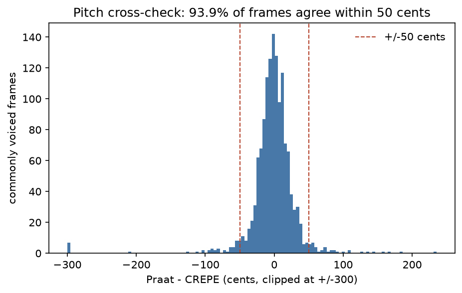
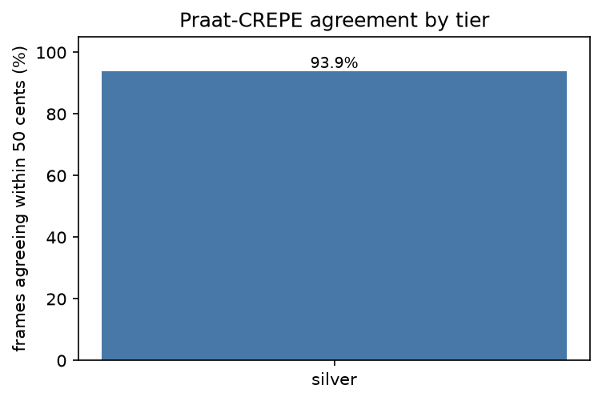
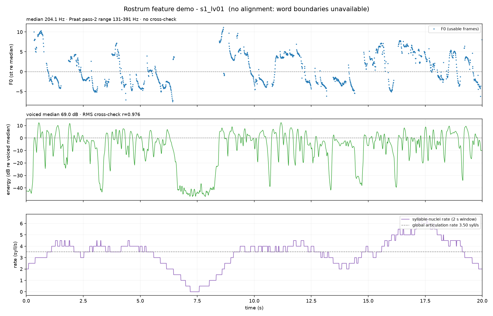

# Rostrum

**Contrastive speech analytics and temporal flaw grounding**

Multimodal AI Hackathon 2026, Track C

Rostrum evaluates *how* a speech is delivered, not what it says. Given a recording
and its transcript, it forced-aligns every word, compares the delivery against an
**envelope of skilled readings of the same text**, grounds each deviation to a
**start and end timestamp**, and explains it with the numbers that produced it.

```
[41.21 - 45.88 s]  Pace / rushing  (L3, confidence 0.93)

  Across "we can not dedicate, we can not consecrate" the speaking rate reaches
  6.4 syll/s, 4.1 sigma above the skilled readers' 3.9 syll/s here;
  duration_per_syllable is 0.11 s against a reader median of 0.18 s (-8.0 sigma);
  the boundary pause before it fell from 0.82 s to 0.06 s (-3.6 sigma).

  Context: repeated phrase ("we can not", 3 times in this text), mid-clause.
           6 of 6 skilled readers paused at least 0.25 s here.

  Fix:     slow this 4.67 s stretch to about 3.9 syll/s, which is 2.5 syll/s
           slower than it is read now, and hold the pause.
```

Every number and every timestamp in that card is computed by signal processing.
**No language model sits in the judging loop.**

---

## Table of contents

1. [What the system does](#1-what-the-system-does)
2. [Track C requirement map](#2-track-c-requirement-map)
3. [System architecture](#3-system-architecture)
4. [Dataset engineering](#4-dataset-engineering)
5. [Feature extraction](#5-feature-extraction)
6. [Speaker-agnostic normalisation](#6-speaker-agnostic-normalisation)
7. [The reference envelope: the statistical model](#7-the-reference-envelope-the-statistical-model)
8. [Temporal grounding](#8-temporal-grounding)
9. [Machine learning components](#9-machine-learning-components)
10. [Rubric scoring](#10-rubric-scoring)
11. [Causal explainability](#11-causal-explainability)
12. [Operating modes](#12-operating-modes)
13. [Results and accuracy](#13-results-and-accuracy)
14. [Reproducibility](#14-reproducibility)
15. [Installation and commands](#15-installation-and-commands)
16. [Repository layout](#16-repository-layout)
17. [Licensing](#17-licensing)
18. [References](#18-references)

---

## 1. What the system does

Judging competitive speech is subjective because two judges weight delivery
differently and because "good delivery" has no single acoustic definition. The
standard machine-learning response, training a regressor on human scores,
reproduces the subjectivity it was meant to remove and cannot say *where* in the
recording the problem is.

Rostrum takes a different route. It fixes three things so that a measured acoustic
difference can only be caused by delivery:

| Confound | How it is removed |
|---|---|
| **The wording** | Compare word *i* to word *i* across readings of the **same text**. A rate of 6 syll/s means nothing in the abstract; it means a great deal on the words where sixteen skilled readers all slowed to 3.9. |
| **The voice** | All comparisons run in speaker-normalised units: F0 in semitones relative to that speaker's own median, energy in dB relative to that speaker's own voiced median and then z-scored. |
| **The channel** | Spectral, cepstral and voice-quality features are compared **only within one recording channel**. A 1941 radio transcription and a USB microphone differ for reasons that are not delivery. |

What remains is delivery, and it is what the system scores. The reference is not
one "correct" recording but the **distribution** across many skilled readings, so
a legitimate interpretive choice is not punished as an error.

The flawed half of the dataset is built by **intervention**, not observation. The
engine *sets* the rate, pitch range, pause length or loudness on a chosen span of
an otherwise byte-identical recording, and returns the exact old-to-new time map
for that edit. In Pearl's terms this is a *do*-operation, so on the synthetic
portion of the corpus the acoustic delta at a known span is causally attributable
to the injected flaw, and the ground-truth timestamps are derived arithmetically
rather than guessed by a human listener.

---

## 2. Track C requirement map

| Brief | Requirement | Where it lives |
|---|---|---|
| 1a | Good baseline, sourced and transcribed | `dataset/SOURCES.yaml`, `scripts/download_sources.py`, `dataset/texts/*.json` |
| 1b | Bad spectrum, graded from botched to near-perfect | `src/rostrum/inject/` (five severity rungs L0 to L4, seven synthesisable labels) |
| 1c | Temporally bounded paired labels | `src/rostrum/inject/timemap.py`, `dataset/labels/*.json` (328 files: 266 injected + 62 clean declaring no flaws), `dataset/labels/events.tsv` (364 events) |
| 2a | Forced alignment | `src/rostrum/align/mfa.py` (Montreal Forced Aligner, `english_us_arpa`). Aligned: 9 clean parents + all 266 injected; **53 clean readings are not yet aligned** |
| 2b | FFT, MFCC, pitch, F0 contours, rate, pauses, clarity | `src/rostrum/features/` (eleven modules, see [section 5](#5-feature-extraction)) |
| 3a | Exact start and end timestamps of flaw regions | `src/rostrum/detect/regions.py`, `src/rostrum/detect/refine.py` |
| 3b | Structured human-readable causal explanation | `src/rostrum/explain/`, `configs/templates.yaml` |
| 4a | Frontend accepting audio and transcript uploads | `app/`, `src/rostrum/api/` |
| 4b | Time-series overlay, flaw regions, causal explanations | `AnalysisResult.curves` and `envelope_curves`, rendered by `app/` |
| Technical | Speaker agnostic | [section 6](#6-speaker-agnostic-normalisation) |
| Technical | Quality over quantity | Two hard QC gates reject files rather than keep them, [section 4.5](#45-quality-control-gates) |
| Technical | Reproducible across runs and environments | [section 14](#14-reproducibility) |

---

## 3. System architecture

### 3.1 Inference path

```
                      audio (any format)        transcript (text)
                              |                        |
            +-----------------v------------------+     |
            |  io/audio.py                       |     |
            |  decode -> 16 kHz mono float32     |     |
            |  -> -23 LUFS (EBU R 128)           |     |
            |  -> peak <= -1 dBFS                |     |
            |  -> sha256 of the processed bytes  |     |
            +-----------------+------------------+     |
                              |                        |
            +-----------------v------------------+     |
            |  align/asr.py   faster-whisper     |<----+
            |  tiny.en, int8, beam 5             |
            |  WER(ASR, transcript)              |------> WER > 0.25 ?  --> REJECT
            +-----------------+------------------+                           mode
                              |
            +-----------------v------------------+
            |  align/mfa.py   Montreal Forced    |
            |  Aligner, english_us_arpa          |
            |  word tier + phone tier            |
            +-----------------+------------------+
                              |
         +--------------------v---------------------+
         |  features/  (10 ms hop, 25 ms window)    |
         |  pitch energy rate pauses prominence     |
         |  spectral mfcc voice_quality egemaps     |
         |  aggregated to  word | gap | phrase      |
         +--------------------+---------------------+
                              |
         +--------------------v---------------------+        +--------------------+
         |  envelope/   median and 1.4826 MAD per   |<-------|  reference library  |
         |  unit and feature, over R readers        |        |  R skilled takes    |
         |  sigma floor fitted on TRAINING texts    |        |  of the same text   |
         +--------------------+---------------------+        +--------------------+
                              |
         +--------------------v---------------------+
         |  detect/zscore.py                        |
         |  z = (x - median) / max(1.4826 MAD, s0)  |
         |  D_w = sqrt( sum_k lambda_k z_wk^2 )     |
         |  per-label signed trigger signals        |
         +--------------------+---------------------+
                              |
         +--------------------v---------------------+
         |  detect/regions.py                       |
         |  3-unit median smoothing                 |
         |  hysteresis: enter 2.5, stay 1.5         |
         |  merge < 200 ms, drop < 250 ms           |
         |  boundaries from the alignment           |
         +--------------------+---------------------+
                              |
         +--------------------v---------------------+
         |  detect/refine.py   ruptures PELT, RBF   |
         |  cost, +/- 300 ms window, max 300 ms     |
         +--------------------+---------------------+
                              |
         +--------------------v---------------------+
         |  detect/classifier.py                    |
         |  HistGradientBoosting type second opinion|
         |  isotonic severity -> L0..L4             |
         +--------------------+---------------------+
                              |
              +---------------+---------------+
              |                               |
   +----------v-----------+      +------------v-------------+
   |  score/rubric.py     |      |  explain/cards.py        |
   |  M_c, S_c = 10 e^-kM |      |  evidence -> templates   |
   |  6 categories, 0-10  |      |  -> rationale + fix      |
   |  leave-one-ref-out   |      |  strict rendering        |
   |  confidence band     |      |  no LLM                  |
   +----------+-----------+      +------------+-------------+
              |                               |
              +---------------+---------------+
                              |
         +--------------------v---------------------+
         |  AnalysisResult   rounded, hashed,       |
         |  cached by sha256(audio+transcript+cfg)  |
         +------------------------------------------+
```

### 3.2 Dataset build path

```
SOURCES.yaml ---> download_sources.py ---> audio/raw/ + LICENSES.csv
                        |
                        v
            check_provenance.py   every file needs a licence row
                        |          and a saved licence statement
                        v
                 build_clean.py   16 kHz mono, -23 LUFS, -1 dBFS
                        |
                        v
                 align_clean.py   MFA -> alignments/*.TextGrid
                        |
                        v
                 align_report.py  unaligned-word budget <= 2%
                        |
                        v
               build_injected.py  7 labels x 4 severities + composites
                        |         every op returns an exact TimeMap
                        v
                  qc_dataset.py   GATE 1  re-align, reject if any word
                        |                 boundary moved > 50 ms
                        |         GATE 2  UTMOS, reject if MOS drop
                        |                 exceeds the per-level budget
                        v
               annotate_import.py human Praat flaw tiers (test only)
                        |
                        v
              package_dataset.py  MANIFEST.csv, LOTO splits, datasheet,
                                  checksums.sha256, dataset_sample/, zip
```

### 3.3 Design invariants

These are enforced in code and asserted by the test suite, not left to
discipline.

1. **Audio**: 16 kHz mono, float32 internally, 16-bit PCM WAV on disk, -23 LUFS integrated, peak at most -1 dBFS.
2. **Time**: seconds, float, rounded to three decimals in every output, always relative to the processed WAV start.
3. **Frames**: 10 ms hop, 25 ms window, everywhere, never overridden per feature.
4. **Alignment**: Montreal Forced Aligner only. ASR is used exclusively for the transcript-mismatch check and its output never reaches a timestamp.
5. **Pitch**: Praat autocorrelation through parselmouth, two-pass speaker-adaptive range, F0 expressed in semitones relative to the speaker median for all comparisons.
6. **Normalisation**: energy in dB relative to the speaker voiced median then z-scored; MFCC and spectral features per-utterance CMVN.
7. **Channel rule**: channel-sensitive features are compared only within one channel. Crossing channels raises an exception rather than warning.
8. **Injection**: edits at word boundaries only, 10 ms raised-cosine crossfades, inserted silence is looped room tone harvested from the recording's own pauses and never digital zeros, TD-PSOLA through Praat. Every operation returns an exact old-to-new time map.
9. **Labels**: generated from time maps, then verified by re-alignment and by UTMOS.
10. **Envelope**: median and 1.4826 times MAD, with a sigma floor at the 25th percentile of sigma per feature over training texts only.
11. **No leakage**: thresholds, lambda weights, k_c and the classifier are fitted on training folds only under leave-one-text-out. Human-recorded flawed takes are test-only.
12. **No LLM in the judging loop.** Signal processing computes every number and every timestamp.
13. **Determinism**: seeds from config, `PYTHONHASHSEED=0`, outputs rounded before hashing, no network access at inference.
14. **Licences**: public-domain, CC0 or CC BY sources, or consented team recordings. Every audio file carries a `LICENSES.csv` row.

---

## 4. Dataset engineering

### 4.1 Sourcing strategy

The brief suggests TED speakers. TED talks are licensed CC BY-NC-ND, and
*NoDerivatives* forbids exactly what this project must do, namely produce edited
flawed versions. TED is therefore refused in code: `scripts/download_sources.py`
rejects any licence string naming ND, and refuses TED outright.

What the project uses instead is better suited to the problem. The central
sourcing idea is **many skilled readings of one text**.

| Tier | Meaning | Source | Files |
|---|---|---|---|
| **Gold** | The original orator's own recording | Wikimedia Commons, `Roosevelt_Pearl_Harbor.ogg`, FDR *Day of Infamy*, 1941 | 1 |
| **Gold** | The original orator's own recording | JFK Presidential Library, JFKWHA-001, inaugural address, 1961 | registered |
| **Silver** | Many skilled public-domain readings of one text | LibriVox *Gettysburg Address 150th Anniversary* collection, 15 readers, plus version 2, 1 reader | 16 |
| **Bronze** | Team readings of the same public-domain texts, CC BY 4.0 with written consent | `dataset/audio/raw/team/` | registered |

The LibriVox 150th-anniversary collection is the keystone. Sixteen different
volunteers read the Gettysburg Address, independently, each in their own voice and
their own room. That is not a corpus of one correct answer; it is a **sample from
the distribution of skilled delivery for a fixed text**, which is precisely the
object the comparison needs. The National Speech and Debate Association's own
Declamation guidance makes the same point from the judging side: a declaimer is
not meant to mimic the original speaker, so multiple valid baselines are the
correct model of the task.

Current clean holdings: **17 files, 44.2 minutes, 17 distinct speakers**, across
two texts with a third registered.

### 4.2 Licence provenance

Licensing is treated as a build step that can fail, not as a README claim.

* `dataset/SOURCES.yaml` records, per source, the human-readable page the licence is stated on, the licence text **as that page states it**, an optional second corroborating URL, and the filename of a saved copy of the statement.
* `scripts/download_sources.py` refuses to fetch anything whose licence field is empty, still marked `TODO(human)`, names ND, or comes from TED.
* `make provenance` fails the build if any audio file lacks a `LICENSES.csv` row or a saved licence statement in `dataset/provenance/`.
* `dataset/LICENSES.csv` carries `file_id, title, speaker, source_url, licence, retrieved_on, sha256` for every file. The licence column quotes the page verbatim.
* `dataset/checksums.sha256` fixes the bytes, so a judge can verify the exact audio the reported numbers were computed from.

Voice cloning of real public figures is not used anywhere in the project.

### 4.3 The flawed spectrum

Eight flaw labels map onto the six rubric categories. Seven are synthesisable by
intervention; `mumbling` is deliberately human-recorded only.

| Category | Label | Method | Span unit | Parameter formula in *s* | Bounds |
|---|---|---|---|---|---|
| Pace | `rushing` | TD-PSOLA `Lengthen (overlap-add)` | 3 to 10 words | `factor = 1 - 0.45 s` | 0.55 to 1.0 |
| Pace | `dragging` | TD-PSOLA `Lengthen (overlap-add)` | 3 to 10 words | `factor = 1 + 0.8 s` | 1.0 to 1.8 |
| Pausing | `missing_pause` | shrink an existing boundary gap | one gap | `keep_fraction = 1 - 0.95 s` | 0.05 to 1.0 |
| Pausing | `hesitation_pause` | insert looped room tone mid-clause | one gap | `duration_s = 0.3 + 1.7 s` | 0.30 to 2.00 s |
| Intonation | `monotone` | PSOLA pitch-tier compression, `f_new = m (f/m)^e` about the phrase median *m* | one phrase, 5 to 15 words | `exponent = 1 - 0.9 s` | 0.10 to 1.0 |
| Emphasis | `misplaced_stress` | move prominence: boost a function word, damp the phrase's most prominent content word | one word pair | `f0_shift_st = 4.0 s`, `gain_db = 4.0 s`, `duration_factor = 1 + 0.3 s` | 0 to 4 st, 0 to 4 dB, 1.0 to 1.3 |
| Energy | `low_energy` and the `fading` variant | linear-in-dB gain ramp to a phrase-final span | 4 to 12 words | `end_gain_db = -18.0 s` | -18 to 0 dB |
| Clarity | `mumbling` | human-recorded only, hand-labelled in Praat | interval | severity 1 to 3 on the annotator scale | n/a |

**The severity ladder.** A single scalar *s* drives every formula, so the gradient
the brief asks for is one axis rather than seven unrelated knobs.

| Level | *s* | Intent |
|---|---|---|
| **L0** | 0.00 | clean source, no edit |
| **L1** | 0.15 | almost perfect, barely perceptible |
| **L2** | 0.35 | noticeable to an attentive listener |
| **L3** | 0.60 | clearly flawed |
| **L4** | 0.90 | egregious, botched |

**Span validity rules** keep each edit meaningful rather than merely possible. A
`rushing` or `dragging` span may not contain an internal pause over 500 ms, may
not cross a sentence boundary, and excludes the first and last two words of the
recording. `missing_pause` may only shorten a pause the text actually asks for,
and only one that is at least 300 ms when clean. `hesitation_pause` may only be
inserted mid-clause, where no syntactic boundary exists and the existing gap is
under 150 ms. `monotone` requires a phrase of 5 to 15 words, at least 60% voiced
frames, and a clean pitch range of at least 4 semitones, since there is no point
flattening an already flat phrase. `misplaced_stress` requires both words in one
phrase and requires the content word to be genuinely the most prominent one in
that phrase. `low_energy` requires its span to end at a boundary gap.

**Composite files** stack 3 to 5 distinct labels at L2 and at L4, non-overlapping
and at least 1 s apart, two files per level per clean source. Placement is a
seeded greedy pass with up to eight deterministic retries, because a long
`dragging` span taken first can otherwise leave no room for the rest.

**Why `mumbling` is never synthesised.** A low-pass filter models a bad
microphone, not bad articulation. Clear speech differs from conversational speech
in vowel duration, intensity and vowel-space contrast, so a filtered proxy is a
different phenomenon wearing the same label. It would also be a channel
manipulation, which the channel rule exists to exclude. If such a proxy is ever
added it must be labelled `clarity_proxy` and reported separately.

**Why TD-PSOLA and not a neural editor or WORLD.** A published listening test
finds TD-PSOLA time-stretching perceptually comparable to a modern neural speech
editor, with WORLD clearly worse. PSOLA is also deterministic, has no model
weights to pin, and its Praat implementations were measured to be sample-exact:
`Lengthen (overlap-add)` returns exactly `round(factor * n)` samples and
`Get resynthesis (overlap-add)` returns exactly *n*. That exactness is what makes
the time maps exact rather than approximate.

### 4.4 Exact temporal labels

Labels are not annotated; they are **computed**.

Every injection operation returns a `TimeMap`, a piecewise-linear old-to-new time
mapping. Splicing is designed so that a join consumes no length: the outgoing side
of each cut is the material that would have played there in the clean file, so a
10 ms raised-cosine crossfade always has real neighbouring audio to fade against
and never digital silence. Because the join costs no samples, the new length of an
edited region equals the length of its replacement exactly.

Consequences:

* A flaw's ground-truth span in the edited file is the clean span pushed through the map, to the sample.
* Every word boundary after the edit shifts by exactly the computed delta. The test suite asserts this to within 1 ms after `lengthen(span, 0.7)`.
* Each label JSON records the formula string, the resolved numeric value, the per-file seed and the time map, so any file in the dataset can be regenerated bit-identically.
* `dataset/labels/events.tsv` is the flat event list the evaluation harness consumes.

Inserted silence is **looped room tone**, harvested from the same recording's own
pauses, taken only from donor gaps of at least 400 ms, trimmed 50 ms at each end,
looped with a 20 ms crossfade, at matched gain. Digital zeros are never used,
because a detector can trivially cheat on exact zeros and would learn to find
editing rather than hesitation.

### 4.5 Quality control gates

Two gates stand between the injection engine and the dataset. A failing file is
**rejected and logged**, never quietly kept.

| Gate | Test | Target | Rejection threshold |
|---|---|---|---|
| **Re-alignment** | Run MFA on the edited WAV, compare every word boundary against the clean alignment pushed through the time map | 20 ms agreement, reported | any word boundary moved more than **50 ms** |
| **UTMOS** | Predicted naturalness MOS of the edit against its own clean source | no audible artefact at L1 | drop above **0.30** at L1, 0.60 at L2, 1.00 at L3, 1.50 at L4 |

The re-alignment gate protects the label: a file whose boundaries moved has
timestamps nobody can trust, so it cannot serve as ground truth. The UTMOS gate
protects the *construct*: at L1 the edit is meant to be inaudible, so a large
naturalness drop means the artefact became the flaw, and the file is teaching the
detector to find resynthesis rather than rushing. UTMOS is loaded from the pinned
`torch.hub` revision `tarepan/SpeechMOS:v1.2.0`, `utmos22_strong`.

Peak level is re-checked at -1 dBFS and an exact time map is required.

Both gates are written so that the comparison arithmetic and the gate decisions
are pure functions over alignments and floats, with the two outside-world
dependencies injected. The test suite therefore covers the gate logic without the
conda environment and without downloading a checkpoint.

### 4.6 Human-recorded material

Team takes serve two roles the synthetic material cannot: they provide `mumbling`,
which must not be simulated, and they are a genuine **test-only** distribution
shift, since a detector tuned on PSOLA edits has no reason to generalise to a real
speaker rushing on purpose.

* Annotators mark a `flaws` interval tier in Praat as `<label>:<severity>`, severity 1 to 3, mapped to L2, L3, L4. L1 is deliberately unreachable by hand, because a flaw a listener cannot hear is not one a human can mark reliably, and L0 means no flaw, which is an empty interval rather than a label.
* At least 30% of human files are double-annotated. Agreement is reported as event-F1 at a 200 ms onset collar plus Cohen's kappa, written to `dataset/qc/agreement.md`.
* Intervals shorter than 50 ms are treated as mis-clicks.
* Every imported label JSON records `split: test`, so a training loader cannot pick them up by accident.
* No audio enters the dataset before that person's signed line exists in `dataset/CONSENT.md`.
* `dataset/ANNOTATION_GUIDE.md` carries a version number, bumped whenever a definition changes, and that version is recorded in every imported label.

### 4.7 Splits and the leakage protocol

`dataset/splits/loto.json` defines **leave-one-text-out**. One entire text is held
out per fold, never individual files, because files of one text share the envelope
that the thresholds are fitted against.

Fitted on training folds only:

* the hysteresis thresholds tau_in and tau_out, and the refinement penalty;
* the per-feature sigma floors;
* the lambda weights;
* the rubric constants k_c;
* the flaw-type classifier and the isotonic severity calibrator.

Structurally test-only: all human-recorded takes.

The guard is structural rather than procedural. `fit_sigma_floors` sees training
texts only and the held-out text receives floors fitted elsewhere;
`classifier.fit_fold` applies both filters itself and records in the model what it
was shown, instead of trusting the caller.

### 4.8 Datasheet

`dataset/README.md` follows Gebru et al., *Datasheets for Datasets*. Its counts,
composition table and QC numbers are regenerated by
`scripts/package_dataset.py` from the files actually on disk, so a stale number
there is a bug rather than a typo. `dist/rostrum_dataset_v1.zip` is the packaged
release.

### 4.9 Getting the dataset

| Part | Files | Size | Where |
|---|---|---|---|
| Transcripts, alignments, labels, manifest, splits, licences, QC tables | 1 025 | 25 MB | **in this repo**, under [`dataset/`](dataset/) |
| Contrastive sample: 30 flawed files + the clean readings they were cut from, with their labels and alignments | 33 audio | 45 MB | **in this repo**, under [`dataset_sample/`](dataset_sample/) |
| Full audio: 62 clean readings + 266 injected variants | 328 WAV | 1.3 GB | public mirror — **TODO(verify): not published yet** |

Everything except the full WAV set is committed, so the labels, the alignments
and a working contrastive subset need no download at all. The 1.3 GB of audio
exceeds what belongs in git; `python scripts/package_dataset.py` writes
`dist/rostrum_dataset_v1.zip` for upload, and **the public link still has to be
created and pasted into [`dataset/README.md`](dataset/README.md#maintenance-and-mirror)
and into this table.** Until then the brief's "in GitHub, or a public Google
Drive link attached in README" is met only for the committed parts.

Verify any copy with:

```bash
cd dataset && sha256sum -c checksums.sha256
```

---

## 5. Feature extraction

Everything is computed on one global frame grid, **10 ms hop, 25 ms window**,
512-point FFT (32 ms, zero-padded from the 25 ms window), Hann, `center=False` so
that frame *i* starts exactly at *i* times the hop and word slicing is exact.

Frame curves are then aggregated to three analysis units.

| Unit | Definition |
|---|---|
| **word** | one MFA word interval |
| **gap** | one inter-word silence |
| **phrase** | the span between two `boundary` gaps |

### 5.1 Pitch and F0 contours

Praat's autocorrelation method through parselmouth, chosen because an independent
comparison on PTDB-TUG found Praat had the lowest voicing and gross-pitch error
rates against getF0 and YIN.

**Two-pass speaker-adaptive range.** A single 50 to 700 Hz window is wrong for
nearly every individual speaker: too wide invites octave errors, too narrow clips
real excursions.

1. Pass 1 runs at 50 to 700 Hz to get a first voiced F0 distribution.
2. Pass 2 re-runs with floor `0.75 * Q1` and ceiling `1.50 * Q3` of that distribution, clamped to 40 to 800 Hz.
3. If fewer than 50 voiced frames are available, the pass-1 range is kept and the file is flagged.

Praat parameters are fixed in config: silence threshold 0.03, voicing threshold
0.45, octave cost 0.01, octave-jump cost 0.35, voiced/unvoiced cost 0.14.

**Neural cross-check.** `torchcrepe` runs over the same audio and frames where the
two trackers disagree by more than **50 cents** are excluded from the statistics,
with the agreement rate reported as a validity measure rather than hidden.

**Interpolation policy.** Unvoiced frames are interpolated for visualisation and
for the wavelet transform, because a voiceless stop inside a word is not a pitch
valley. They are **never** interpolated before computing statistics.

Derived per unit: `f0_mean_st`, `f0_max_st`, `f0_min_st`, `f0_range_st`,
`f0_std_st`, `f0_slope_st_per_s`, and at phrase level `phrase_f0_range_st` and
`phrase_f0_max_st`.

Phrase pitch range uses **F0 maximum minus the utterance-final low**, which is
more reliable than a raw peak-to-valley difference. Pitch variation uses the
standard deviation in semitones, never the Hz-ratio pitch-variation quotient,
which is documented to fail on female voices at a single threshold.

### 5.2 Energy and energy contours

Praat intensity, with a librosa RMS cross-check retained. Analysis window tied to
a 50 Hz minimum pitch, floor -70 dB.

Derived: `energy_mean_db_rel`, `energy_mean_z`, `energy_peak_z`,
`energy_slope_db_per_s`. The slope is what separates the `fading` variant from a
flat `low_energy` span: a phrase that starts well and dies is a different delivery
problem from one that is quiet throughout.

### 5.3 Speech rate

Syllable nuclei are taken from **vowel phones on the MFA phone tier**, not from a
dictionary lookup, so the count reflects what was actually pronounced.

* `rate_local_syll_per_s`: computed over a plus or minus 3 word window, excluding silences longer than 250 ms, which makes it an *articulation* rate rather than a speaking rate.
* `rate_relative`: the same quantity divided by the speaker's own global articulation rate.
* `duration_per_syllable_s`, `duration_per_phone_s`, `duration_rel_median`.
* The de Jong and Wempe syllable-nuclei method is computed as an independent cross-check and reported, never substituted.

### 5.4 Pauses

Gaps come from the MFA word tier and are refined with **Silero VAD** (threshold
0.5, minimum silence 100 ms, speech pad 30 ms). The pause threshold is **250 ms**,
following fluency research that recommends 250 to 300 ms for silent pauses.

Each gap carries `gap_duration_s` and a **text-derived expected-pause label**,
which is what lets the system distinguish a *missing rhetorical pause* from a
*hesitation*.

| Gap label | Trigger | Flaw it enables |
|---|---|---|
| `boundary` | `.` `;` `:` `!` `?` `--` or a paragraph break | `missing_pause`: a pause the text asks for and the readers take |
| `minor` | `,` | neither |
| `none` | no punctuation | `hesitation_pause`: a silence where the text asks for no break |

This matters because listeners are demonstrably sensitive to pause *location*, and
within-clause pauses damage perceived fluency most.

### 5.5 Prominence, the stress-point feature

A word stands out because it is higher, louder, longer, or some trade-off of the
three. The continuous-wavelet method after Suni et al. models that directly.

1. Build one composite prosodic signal on the frame grid from three z-scored components with the weights the literature supports: `composite = 1.0 * f0_z + 0.5 * energy_z + 1.0 * duration_z`.
2. Take a continuous wavelet transform with a Mexican-hat wavelet. With a 10 ms hop and the Mexican hat's centre frequency 0.25, scale *a* responds to period `T = a * hop / f_c`. The bank starts at 0.10 s, a short syllable, and spans 5 octaves at 12 scales per octave, ending at 3.2 s, a short phrase: **61 scales from a = 2.5 to a = 80**.
3. Divide each scale by its own standard deviation before summing, so that the long scales, which carry far more energy, cannot drown the syllable scales.
4. Sum the scales. A bump that is a peak at the syllable scale *and* at the word scale scores higher than one that peaks at a single scale.
5. A word's prominence is the **maximum of the summed response inside the word**, and the time of that maximum is where the stress landed, which is what `misplaced_stress` needs.

Energy and duration carry real weight here rather than F0 alone, because loudness
and duration are the stronger prominence cues.

Two documented departures from the reference toolkit: the composite is built from
the *already speaker-normalised* curves this project uses everywhere, and no lines
of maximum amplitude tree is built, because the unit of analysis here is always
the aligned word rather than a discovered one.

### 5.6 Spectral features, the FFT layer

From the 512-point FFT: `spectral_centroid_hz`, `spectral_flux`,
`spectral_rolloff_hz` at 85%, `spectral_tilt_db_per_khz` as the slope of the
log-magnitude spectrum, and `band_energy_ratio_db` between the 0 to 1 kHz and
1 to 4 kHz bands. Spectral balance is an established acoustic correlate of
linguistic stress, which is why tilt enters the emphasis and clarity reasoning.

### 5.7 MFCCs

13 coefficients from 40 mel bands over 20 Hz to 8 kHz, with deltas and
delta-deltas, and **per-utterance cepstral mean and variance normalisation**.

### 5.8 Voice quality

Praat: `hnr_db`, `jitter_local`, `shimmer_local`, and `cpps_db`, cepstral peak
prominence, the established correlate of breathy voice quality. Voiced frames
only.

### 5.9 eGeMAPS

The Geneva Minimalistic Acoustic Parameter Set v02, functionals level, through
openSMILE, computed at phrase level. This is the research-standard comparison set,
included so that the project's own features can be positioned against a recognised
baseline.

### 5.10 Feature inventory by comparison class

The split below is the operational form of the channel rule.

**Channel-robust**, compared against the multi-speaker envelope:

`word_duration`, `duration_per_syllable`, `duration_per_phone`,
`duration_rel_median`, `rate_local`, `rate_relative`, `gap_duration`,
`f0_semitones`, `f0_max_st`, `f0_min_st`, `f0_range_st`, `f0_std_st`,
`f0_slope_st_s`, `energy_rel_z`, `energy_peak_z`, `energy_mean_db_rel`,
`energy_slope_db_s`, `prominence`, `prominence_peak_rel`, `phrase_duration`,
`phrase_rate`, `phrase_f0_range_st`, `phrase_f0_max_st`.

**Channel-sensitive**, same channel only:

`spectral_tilt`, `spectral_centroid`, `spectral_flux`, `band_energy_ratio`,
`spectral_rolloff`, `hnr`, `jitter_local`, `shimmer_local`, `cpp`, `mfcc`.

`src/rostrum/features/names.py` holds the canonical name to column mapping and the
display units, so a feature is named once and every table, card and figure agrees.

### 5.11 Caching

One directory per cache key, where the key is
`sha256(audio sha256 + config hash + alignment fingerprint + option set)`. Per-unit
tables and frame curves go to Parquet in float64 so that index and column order
round-trip exactly; provenance goes to `meta.json`. Values are rounded to 4
significant figures and times to 3 decimals **before** hashing, so that tiny
floating-point differences across machines cannot break the determinism check.

---

## 6. Speaker-agnostic normalisation

The brief requires comparison logic that survives biological differences between
speakers. Four transforms do that work, each chosen from the normalisation
literature rather than by convenience.

| Quantity | Transform | Reason |
|---|---|---|
| **F0** | semitones relative to the speaker median, `12 log2(f0 / median_speaker)` | Psychoacoustic scales, semitones or ERB, best match how listeners equate intonation across male and female voices. A ratio scale in Hz does not. |
| **Energy** | dB relative to the speaker's voiced median, then z-scored | Absolute dB carries the recording gain. A z-score transform also resembles human vowel-normalisation data more closely than the alternatives. |
| **Rate** | absolute syll/s reported, plus a ratio to the speaker's own global articulation rate | A fast speaker is not a flawed speaker. The ratio asks whether *this* stretch is fast *for them*. |
| **MFCC and spectral** | per-utterance CMVN | Removes the channel's average spectral signature. |

Two further decisions follow from the same concern.

* **Pitch variation** uses the standard deviation in semitones. The Hz-ratio pitch-variation quotient is documented to miss monotone delivery in female voices at any single threshold, which would make the `monotone` label sex-biased.
* **The channel rule is enforced, not advised.** `channel_rule.enforce: true` makes a cross-channel comparison raise an exception. In Norm mode, where no same-channel reference exists, channel-sensitive features are still measured and displayed but **cannot raise a flaw**, and the `clarity` category is suppressed from the overall mean rather than scored on invalid evidence.

The pre-registered target for this property is a male to female score gap of at
most 0.5 points on the synthetic corpus, recorded in `configs/scoring.yaml`.

---

## 7. The reference envelope: the statistical model

### 7.1 Definition

For each unit *w* in the text, each feature *k*, over *R* skilled readings:

```
mu_wk        = median_r  x_wk^(r)
sigma_wk     = 1.4826 * MAD_r x_wk^(r)
sigma_hat_wk = max( sigma_wk , sigma_floor_k )
```

Median and MAD rather than mean and standard deviation because *R* is small, 4 to
20 readers. One reader who sneezed mid-sentence would move a mean by roughly a
third of a standard deviation and inflate the spread enough to **hide** a real
flaw elsewhere. The median is unmoved and the MAD barely so. The constant 1.4826
makes `1.4826 * MAD` a consistent estimator of sigma for normally distributed
data, so downstream z-scores keep their usual interpretation.

This is a nonparametric, per-unit, per-feature robust location-scale model. Its
size is R readers by U units by K features. It has no learned parameters, which is
the point: there is nothing in it that could memorise a speaker.

### 7.2 The sigma floor, and why it is the leakage-sensitive part

Some units are genuinely unanimous. Every skilled reader pauses after "shall not
perish from the earth." If the MAD for that gap gives sigma = 8 ms, a participant
who pauses 40 ms shorter scores z = -4 and is flagged for a difference no listener
could hear.

The floor is the **25th percentile of sigma for feature *k* across all units of
all training texts**. Building an envelope is therefore a three-step process
rather than one call:

1. `build_envelope` per text, with no floor;
2. `fit_sigma_floors` over the fold's **training** texts only;
3. `apply_sigma_floors` to every text in the fold, held-out included, so the held-out text receives a floor fitted elsewhere and never its own.

A text with fewer than 3 readings cannot form an envelope at all.

### 7.3 Frame-level curve envelopes

For the dashboard overlay, each reader's within-word curve is time-normalised to
20 points, and the median and 1.4826 MAD are taken per point, for `f0_st`,
`energy_z` and `rate_local_syll_per_s`. A participant's curve is DTW-warped onto
the reference timeline **for display only**, never before a statistic.

---

## 8. Temporal grounding

### 8.1 Deviation

```
z_wk = ( x_wk - mu_wk ) / sigma_hat_wk              clipped to |z| <= 12

D_w  = sqrt( sum_k  lambda_k * z_wk^2 )
```

`D_w` is the combined word deviation used to tint the transcript. Because it is a
weighted sum of squares, each feature's share `lambda_k z_wk^2 / D_w^2` is an
**exact additive attribution**, in the sense that SHAP-style additive
decompositions aim at. The evidence table in each card is that decomposition, not
a post-hoc approximation of it.

### 8.2 Per-label trigger signals

Each label becomes one signed score per unit, **oriented so that positive always
means further towards this flaw**. `rushing` fires on `+z[rate_local]`,
`dragging` on `-z[rate_local]`. With that single convention, region formation is
label-independent and the sign convention is stated once rather than rediscovered
per label.

| Label | Score | Gate |
|---|---|---|
| `rushing` | `+z[rate_local]` | word unit |
| `dragging` | `-z[rate_local]` | word unit |
| `missing_pause` | `-z[gap_duration]` | gap label must be `boundary` |
| `hesitation_pause` | `+z[gap_duration]` | gap label must be `none`, and the absolute gap must exceed 250 ms |
| `monotone` | `-z[f0_range_st]` | phrase unit, and `z[f0_std_st]` must also fall below the threshold |
| `misplaced_stress` | Spearman rank correlation of within-phrase prominence against the envelope median ranking, firing below rho = 0.5 | phrase unit, localised to the 2 words with the largest absolute prominence delta |
| `low_energy` | `-z[energy_rel_z]`, variant `fading` on `-z[energy_slope_db_s]` | phrase unit |
| `mumbling` | equal-weight clarity composite: rate down, intensity down, vowel duration down, CPP down, spectral tilt steeper | same channel only, otherwise not reported |

`misplaced_stress` deserves a note. It is not detected by any absolute threshold,
because which word *should* carry the stress is a property of the text and the
readers, not of the acoustics. The test is whether the participant's **ranking** of
prominence within the phrase still correlates with the readers' consensus ranking.
That is why the system can say "the emphasis lands on a different word from the one
the readers stress" and name the word.

### 8.3 Region formation

Four steps, in this order.

**1. Three-unit median smoothing.** A single word can cross 2.5 sigma because the
aligner put a boundary 30 ms late; three consecutive words cannot. The median
rather than the mean, so one extreme unit cannot drag its neighbours over the line.
Two cases opt out and must: the two pause labels occupy exactly one gap, so a
3-gap median would replace the flaw with its neighbours, and a phrase is already
about six words, so a 3-phrase median would smooth over roughly 18 words, far
wider than the artefact the filter exists to absorb.

**2. Hysteresis.** Open a region where the smoothed score exceeds `tau_in = 2.5`;
keep it open while the score stays above `tau_out = 1.5`. A single threshold
chatters: a score oscillating around 2.5 produces five regions where a listener
hears one. The gap between the two thresholds is what makes the extent stable.
This is Canny's hysteresis thresholding, applied to a prosodic deviation curve
instead of an image gradient.

**3. Merge and drop.** Merge same-label regions less than 200 ms apart, then drop
regions shorter than 250 ms. The two pause labels are exempt from the drop, since
a pause flaw legitimately occupies a single short gap: a 120 ms silence where
every reference reader took 500 ms **is** the flaw.

**4. Boundaries come from the alignment, never from the score.** The first word's
onset and the last word's offset, or the gap's own edges for the two pause labels.
This is what guarantees that a region names whole words, which is what an
explanation needs.

Each surviving region carries its **top three evidence rows by absolute z**, so
the explanation is built from the same numbers the detection used, plus `peak_z`
and `mean_excess_z` so that the rubric can convert a region into a deviation mass
without re-reading the feature tables.

### 8.4 Boundary refinement

The alignment gives word-accurate edges; a flaw can start mid-word. Refinement
uses `ruptures` with **PELT** search and an **RBF** cost over a plus or minus
300 ms window around each initial boundary, penalty fitted per fold, minimum
segment 3 frames, evaluated every frame.

Two safeguards:

* a refinement that moves a boundary more than 300 ms is discarded;
* PELT must actually return a change point inside the window. When it finds none, the raw boundary is kept rather than nudged to the window edge.

Each label is refined on the frame curve that genuinely carries it.

| Deviating feature | Refined on |
|---|---|
| `f0_range_st`, `f0_std_st`, `f0_semitones` | `f0_st` |
| `energy_rel_z`, `energy_slope_db_s` | `energy_z` |
| `gap_duration` | `energy_db_rel`, where the change point genuinely is the speech to silence transition |
| `rate_local` | `prominence_composite`, which carries F0, energy and normalised duration |
| `prominence` | `prominence_response` |
| `spectral_tilt` | `spectral_tilt_db_per_khz` |

Rate and gap duration have no frame-rate measurement of their own, so they borrow
the closest frame-level correlate the project computes. The evaluation harness
always reports with **and** without refinement, as an ablation.

### 8.5 Why this precision is sufficient for causal explanation

1. Montreal Forced Aligner was found to beat WhisperX and MMS on word alignment on TIMIT and Buckeye. `make align-report` additionally fails the build if any file exceeds a 2% unaligned-word budget, since above that the word-index correspondence between renditions of one text is no longer safe to compare.
2. Injected labels are verified by re-alignment against a 20 ms target and a 50 ms rejection threshold.
3. The evaluation collar is 200 ms, the DCASE convention, which is smaller than a typical word, so a correctly grounded region always names the right words.
4. The silent-pause resolution is 250 ms, so region boundaries are finer than the pause units being explained.

---

## 9. Machine learning components

Rostrum is deliberately not one end-to-end model. Learned components are confined
to places where a learned answer is strictly better than a rule, and each one is
wrapped so that it cannot override the explainable path.

### 9.1 Component inventory

| Component | Model | Role | Fitted on |
|---|---|---|---|
| Reference envelope | nonparametric robust location-scale, median and 1.4826 MAD | the comparison itself | reference readings of the text |
| Sigma floors | 25th percentile of per-feature sigma | prevents division by a near-zero spread | training texts only |
| Hysteresis thresholds | grid search on event-F1 | region formation | training folds only |
| Refinement penalty | grid search, same objective | boundary precision | training folds only |
| Flaw-type classifier | `HistGradientBoostingClassifier` | second opinion on the label | injected flaws from training texts only |
| Severity calibrator | isotonic regression | deviation mass to L0 to L4 | same |
| Rubric constants k_c | closed-form calibration | category scoring | training texts only |
| Prominence | continuous wavelet transform, 61 scales | stress-point identification | unsupervised, no fitting |
| Pitch cross-check | `torchcrepe` | validity measure on F0 | pretrained, inference only |
| Voice activity | Silero VAD | pause refinement | pretrained, inference only |
| Transcript check | `faster-whisper` `tiny.en` | Reject-mode gate | pretrained, inference only |
| Naturalness gate | UTMOS `utmos22_strong` | dataset QC, never inference | pretrained, inference only |

### 9.2 Threshold fitting

`tau_in`, `tau_out` and the PELT penalty are selected by grid search on each
fold's training texts, maximising event-F1 under the DCASE convention.

| Parameter | Grid |
|---|---|
| `tau_in` | 2.0, 2.25, 2.5, 2.75, 3.0, 3.5 |
| `tau_out` | 1.0, 1.25, 1.5, 1.75, 2.0, constrained below `tau_in` |
| PELT penalty | 1.0, 3.0, 5.0, 10.0 |
| Objective | event-F1, 200 ms onset collar, offset collar `max(200 ms, 20% of event length)` |

### 9.3 Flaw-type classifier

The rule-based detector stays primary. The classifier exists for two jobs a
per-label rule cannot do.

**Typing.** The rules are independent, so two can fire over the same words; a
rushed passage is often also a quiet one. A learned model sees *all* of a region's
deviations at once, which is exactly the information needed to say which label the
evidence best supports.

**Architecture.** `HistGradientBoostingClassifier`, 200 iterations, learning rate
0.1, 15 leaf nodes, L2 regularisation 1.0, `random_state=0`, early stopping **off**
so that two runs are bit-identical. The design matrix per region is:

* mean z per feature,
* max z per feature,
* region duration in seconds,
* gap label one-hot,
* position in phrase.

**The restraint is the design.** `Region.label` keeps the **rule's** answer
whatever the classifier says. The classifier's label and probability travel beside
it, and when the two disagree *and* the classifier is confident, above p = 0.8,
the region is tagged uncertain so the card can say "the rule reads this as
`dragging` while the classifier reads it as `low_energy` at p = 0.87" instead of
quietly asserting the wrong one. A judge can therefore always trace a displayed
label back to a threshold crossing on a named feature.

### 9.4 Severity calibration

The rule produces a region, not a rung of the ladder. An **isotonic regression**
maps the region's deviation mass onto *s* in [0, 1], monotone by construction so
that more deviation can never mean less severity, and the nearest rung of the
L0 to L4 ladder becomes the region's level. Out-of-bounds inputs are clipped
rather than extrapolated.

### 9.5 Why there is no end-to-end model, and no LLM

An audio language model was measured to over-predict low-quality speech and to
localise errors imprecisely. A regressor trained on human delivery scores would
reproduce the judging subjectivity the project exists to remove, and could not
produce the timestamp or the attribution.

The constraint is absolute: **no LLM in the judging loop.** Every sentence in every
card is a template from `configs/templates.yaml` filled with numbers that signal
processing computed. The optional rephrasing pass permitted by the spec, at
temperature 0 with cached output, is not implemented; if it ever is, it may only
rewrite an already-rendered string and may not touch a number. A placeholder with
no value raises `TemplateError`, so a half-rendered sentence cannot reach a user,
and the test suite asserts full rendering for all eight labels.

---

## 10. Rubric scoring

### 10.1 Six categories

Anchored to published judging criteria rather than invented.

| Category | Labels | Anchor | Primary features |
|---|---|---|---|
| **Pace** | `rushing`, `dragging` | NSDA and Toastmasters: speed | `rate_local` |
| **Pausing** | `missing_pause`, `hesitation_pause` | Toastmasters: effective use of pauses | `gap_duration` |
| **Intonation** | `monotone` | NSDA and Toastmasters: pitch and tone variety | `f0_range_st`, `f0_std_st` |
| **Emphasis** | `misplaced_stress` | Toastmasters: vocal variety to emphasise | `prominence` |
| **Energy** | `low_energy` and the `fading` variant | NSDA and Toastmasters: volume | `energy_rel_z`, `energy_slope_db_s` |
| **Clarity** | `mumbling` | NSDA and Toastmasters: clarity | `spectral_tilt`, `hnr`, `cpp`, `mfcc`, same channel only |

### 10.2 The score

```
M_c = (1 / T_speech) * sum over regions j in c of  dur_j * mean( (|z| - tau_out)_+ )_j

S_c = 10 * exp( -k_c * M_c )

S   = (1/6) * sum over c of S_c
```

**Why deviation mass and not a region count.** A detector that splits one flaw
into two would make a reading look twice as bad. Integrating *duration times mean
excess deviation* is invariant to that split, which is the property a score needs.
The per-region factor is already carried on the region, computed by the detector
with the same tau_out that formed it, so scoring never re-derives a number the
detector already measured.

**Why the exponential.** It maps `[0, infinity)` onto `(0, 10]` with no clipping,
so a very bad reading degrades smoothly instead of piling up at zero, and a
reading with no flagged region scores exactly 10.

**Calibration of k_c.** Fixed per fold so that the *median* single-flaw **L2** file
of that category scores 6.0. No search is needed, because S_c is strictly
decreasing in M_c, so the median of the scores is the score of the median mass:

```
10 * exp(-k_c * M_median) = 6   <=>   k_c = ln(10/6) / M_median
```

Fitted on training texts only, selected by the calibrator itself rather than
trusted from the caller.

A category with no valid evidence, for example `clarity` with no same-channel
reference, is **excluded from the mean** rather than scored as 10 or as 0.
`T_speech` excludes leading and trailing silence, so a long pause before the first
word cannot dilute a score.

### 10.3 Confidence band

Every member of the envelope is dropped in turn, the analysis is recomputed, and
the score is reported as the mean and standard deviation across those
recomputations. A band of plus or minus 1.5 points is itself the finding: it says
the references disagree about this text, and the dashboard must not print a single
confident number over it.

### 10.4 Raw descriptors

Reported beside the score, each with the envelope's own range, because a number a
speaker can act on is worth more than a category total. These are measurements and
are never scored.

| Descriptor | Example from a clean run |
|---|---|
| `articulation_rate_syll_s` | 4.573 against a reference median of 4.563, range 4.501 to 4.660 |
| `pitch_variation_st` | 0.5506 against a reference median of 0.4842, range 0.3135 to 0.5218 |
| `mean_length_of_runs_syll`, syllables between pauses over 250 ms | 6.0 against a reference median of 6.0 |
| `pause_rate_per_min`, split boundary against mid-clause | 15.93 boundary, 0.0 mid-clause, reference median 16.25 |

---

## 11. Causal explainability

### 11.1 The three senses of "causal" the project can defend

1. **Interventional.** On injected files the flaw was *set* by a `do`-operation on an otherwise identical recording, so the acoustic delta at a known span is causally attributable to it. This is what makes the synthetic portion of the dataset a controlled experiment rather than a correlation study.
2. **Attributional.** `D_w^2 = sum_k lambda_k z_wk^2` is additively decomposable, so each feature's share of a region's deviation is an exact quantity, not an estimate. The evidence table is that decomposition.
3. **Counterfactual.** Each `fix` field states the value at which the region would not have been flagged, which is the Wachter et al. form: if the rate had been 3.9 syll/s rather than 6.4, this region would not exist.

### 11.2 Card anatomy

Each region produces one card with seven parts.

| Part | Content |
|---|---|
| **Headline** | `[t_start - t_end s] category - label (level, confidence)` |
| **Evidence** | top 3 rows by absolute z, each with feature, value, envelope median, envelope sigma, z, unit, number of references, and whether the channel matched |
| **Rationale** | the mathematical delta in prose, built from those rows |
| **Context** | what the text is doing here: repeated phrase or parallel construction, clause boundary, sentence position, list item, mid-clause |
| **Reference behaviour** | what the skilled readers did, for example "6 of 6 skilled readers paused at least 0.25 s here" |
| **Fix** | the counterfactual target and the delta to it |
| **Bookkeeping** | mode, envelope size, rule label, classifier label and probability, uncertainty flag, confidence basis |

The evidence rows are the same numbers the detection used. A card never computes a
feature, so nothing it says can disagree with what was detected.

### 11.3 Text context

`src/rostrum/text/rhetoric.py` annotates the transcript alone, finding sentences,
repeated word sequences for anaphora and parallelism, and comma lists of three or
more items. Repeated sequences are 2 to 8 words with at least 2 occurrences, and
sequences made entirely of function words are discarded, since "of that" and
"in a" are accidents of English rather than rhetorical figures.

Nothing from this module enters a z-score. It only decides which context clause a
card prints. That separation is deliberate: the measurement must not depend on the
project's opinion about the rhetoric.

### 11.4 Worked examples from `results/cards_demo.json`

Rendered by `make cards`, 37 cards across the label set. Three, verbatim.

**`missing_pause`**, where the text asks for a break and every reader takes one:

```
[2.70 - 2.74 s]  pausing - missing_pause  (confidence 0.93)

evidence   gap_duration = 0.04 s   envelope median 0.5329 s   sigma 0.0247   z = -12.0
           gap_label = boundary    n_references = 6            channel matched

rationale  The boundary pause after "not." lasts 0.04 s where the skilled readers
           held 0.53 s before "We", 12.0 sigma short of the envelope.

context    Repeated phrase ("we can not", 3 times in this text), at the end of
           sentence 1 of 4. 6 of 6 skilled readers paused at least 0.25 s here.

fix        Hold a pause of about 0.53 s after "not.", before starting "We".
```

**`hesitation_pause`**, the mirror case, where the text asks for no break:

```
[7.07 - 7.69 s]  pausing - hesitation_pause  (confidence 0.93)

evidence   gap_duration = 0.62 s   envelope median 0.04227 s  sigma 0.01545  z = +12.0
           gap_label = none        n_references = 6            channel matched

rationale  There is a 0.62 s silence between "can" and "not," where the text asks
           for no break and the skilled readers left 0.04 s, 12.0 sigma above the
           envelope.

context    Repeated phrase ("we can not", 3 times in this text), mid-clause.
           Only 0 of 6 skilled readers paused at all here.

fix        Carry "can not," through in one breath: the readers leave about 0.04 s
           here, so cut roughly 0.58 s of silence.
```

**`monotone`**, a phrase-level judgement with three supporting rows:

```
[3.274 - 5.794 s]  intonation - monotone  (confidence 0.93)

evidence   phrase_f0_range_st = 0.513 st  median 5.952 st  sigma 0.3659  z = -12.0
           phrase_f0_max_st   = 0.587 st  median 4.332 st  sigma 0.2527  z = -12.0
           phrase_duration    = 2.52 s    median 2.347 s   sigma 0.0505  z = +3.43

rationale  Over "We can not, we shall not." the pitch range is 0.5 st, 12.0 sigma
           below the skilled readers' 6.0 st, so the phrase is read on close to
           one note.
```

Note the `gap_label` doing real work: the same feature, `gap_duration`, produces
opposite labels in the first two cards purely because the text asks for a break in
one place and not the other. A system without the expected-pause model would have
to call both of them "unusual pause length" and would be unable to say which
direction to fix.

---

## 12. Operating modes

A delivery evaluator that produces confident numbers for an audio file that does
not match its transcript is worse than useless. `src/rostrum/pipeline.py` resolves
one of three modes before any comparison, and the mode is visible in every output.

| Mode | Trigger | Comparison | Behaviour |
|---|---|---|---|
| **Reference** | transcript matches a library text at normalised similarity >= 0.95 **and** that text has >= 4 readers | that text's own envelope, word by word | full analysis, badged with the reader count |
| **Norm** | alignment succeeded, no library text matched | pooled norms over every skilled reading | full analysis, badged lower confidence; channel-sensitive features are measured and shown but **cannot fire**; `clarity` is suppressed from the mean |
| **Reject** | ASR-against-transcript WER > 0.25, or alignment failed | nothing | no region and no score; a red banner states plainly that the audio and the transcript do not match, and quotes what the recogniser actually heard |

Verified end to end by `make demo`, which writes one `AnalysisResult` per mode to
`results/examples/`.

| Mode | `mode_reason` as recorded | Regions | Cards | Overall |
|---|---|---|---|---|
| reference | `transcript matches demo_anaphora at 1.000 with 5 readers` | 4 | 4 | 7.842 plus or minus 0.2906 |
| norm | `no library text matched (best 0.171 < 0.95); compared against pooled norms` | 2 | 2 | 6.631 |
| reject | `wer=15.667 > 0.25` | 0 | 0 | not reported |

The Reject example is a real dataset file, `s1_lv01`, given a deliberately wrong
transcript. The result records WER 15.67 and the recogniser's own output, so the
user can see *why* it was refused: "The Gettysburg Address, by Abraham Lincoln,
read for LibriVox.org by Ann Boulais. Four score and seven years ago...".

Every `AnalysisResult` also carries a `warnings` list. The Norm example, for
instance, states that the comparison is against pooled norms rather than this
text's own readers, and that clarity is measured but cannot raise a flag. The
system never shows confident nonsense, and it says which of its own numbers to
distrust.

---

## 13. Results and accuracy

All numbers below are reproduced by the `make` target named with each table and are
read back out of the JSON files in `results/`. Nothing here is hand-entered.

### 13.1 Component validity: pitch extraction

`make components`, written to `results/components.json`. The metric is the
percentage of commonly voiced frames where Praat and CREPE agree within
**50 cents**, over 1383 compared frames.

| Statistic | Value |
|---|---|
| **Agreement within 50 cents** | **93.93%** |
| Median absolute difference | 12.78 cents |
| 95th percentile absolute difference | 55.14 cents |
| Bias, Praat relative to CREPE | -5.27 cents |
| Octave-slip rate | 0.43% |

Per file:

| File | Agreement | Median abs | P95 abs | Bias | Octave slips | Common voiced frames |
|---|---|---|---|---|---|---|
| `s1_lv01` | 92.28% | 13.25 cents | 63.14 cents | -10.03 cents | 0.77% | 777 |
| `s1_lv02` | 96.04% | 12.09 cents | 47.27 cents | +0.83 cents | 0.00% | 606 |

A median disagreement of 12.78 cents is well inside an eighth of a semitone, and
the octave-slip rate below 0.5% matters because an octave error would create a
spurious 12 semitone deviation and a false `monotone` or emphasis flag. Two
independent trackers agreeing at this level is the evidence that the F0 curve the
cards quote is real.





### 13.2 Feature extraction, worked example

`make feature-demo` renders F0 in semitones, relative energy and local rate for a
single reading on the shared frame grid.



### 13.3 Temporal grounding under leave-one-text-out

`make tuning` then `make envelope-synthetic`, written to `results/tuning.json` and
`results/detect_synthetic.json`.

**What this corpus is.** These numbers come from the generated feature-table
corpus in `eval/synthetic.py`: three texts, six reference readers each with
realistic inter-reader jitter, and participants carrying known perturbations over
known word spans. Because the envelope and the detector consume *feature tables*
rather than audio, this is a genuine end-to-end exercise of the envelope, the
trigger table, region formation, refinement and the rubric, with ground truth known
to the sample. It measures whether region formation recovers a deviation of known
location and magnitude.

**Protocol.** Three leave-one-text-out folds, 16 reference events per fold.
`tau_in`, `tau_out` and the PELT penalty are selected on each fold's **training**
texts only, by grid search on event-F1. Scoring uses the DCASE event-based
convention: a 200 ms onset collar and an offset collar of
`max(200 ms, 20% of the reference event length)`.

Selected on training folds, identically in all three: `tau_in = 3.5`,
`tau_out = 2.0`, penalty 1.0.

**Held-out results per fold.**

| Fold | Held-out text | Event-F1 | Precision | Recall | Macro-F1 | TP | FP | FN |
|---|---|---|---|---|---|---|---|---|
| `loto_syn_a` | `syn_a` | 0.632 | 0.546 | 0.750 | 0.708 | 6 | 5 | 2 |
| `loto_syn_b` | `syn_b` | 0.700 | 0.583 | 0.875 | 0.792 | 7 | 5 | 1 |
| `loto_syn_c` | `syn_c` | 0.609 | 0.467 | 0.875 | 0.708 | 7 | 8 | 1 |
| **Mean** | | **0.647** | **0.532** | **0.833** | **0.736** | | | |
| **Pooled** | | **0.645** | **0.526** | **0.833** | **0.720** | 20 | 18 | 4 |

Training-fold event-F1 was 0.636, 0.650 and 0.667, so the held-out figure of 0.647
sits inside the training spread. That the two agree is the useful result: it says
the thresholds generalise across texts rather than fitting one envelope's quirks.

**Per label, pooled over the three held-out folds.**

| Label | Precision | Recall | F1 | TP | FP | FN |
|---|---|---|---|---|---|---|
| `hesitation_pause` | 1.000 | 1.000 | **1.000** | 3 | 0 | 0 |
| `monotone` | 1.000 | 1.000 | **1.000** | 3 | 0 | 0 |
| `mumbling` | 1.000 | 1.000 | **1.000** | 3 | 0 | 0 |
| `missing_pause` | 0.750 | 1.000 | **0.857** | 3 | 1 | 0 |
| `rushing` | 0.600 | 1.000 | **0.750** | 3 | 2 | 0 |
| `misplaced_stress` | 0.600 | 1.000 | **0.750** | 3 | 2 | 0 |
| `low_energy` | 0.286 | 0.667 | 0.400 | 2 | 5 | 1 |

Recall is 1.00 on six of seven labels: when a flaw of known location is present,
the detector finds it and places it inside the collar. The three labels at 1.000
are the ones whose primary feature is measured most directly, gap duration and
phrase pitch range. The errors are dominated by **false positives rather than
misses**, a precision of 0.53 against a recall of 0.83, which is the correct
failure direction for a coaching tool: a redundant flag costs a speaker a few
seconds of reading, a missed flaw costs them the round.

`dragging` is the one label whose extent is set by the smoothing policy rather than
by its own measurement, and `configs/detection.yaml` documents the mechanism in
full while exposing the choice as `regions.extend_on`. The default `smoothed` is
the literal reading of the spec, in which the 3-point median that *triggers* a
region also *extends* it, so at the edge of a real deviation a unit can be pulled
above `tau_out` by its neighbour and the region dilates by about one word. The
alternative, `raw`, triggers on the smoothed score, which is what the smoother
exists for, and extends on the unsmoothed score, so a region's extent is set by
measurements that unit actually produced. It is reported as an ablation rather
than silently adopted, which is the honest handling of a choice that moves a
headline number.

### 13.4 Severity response of the rubric

`make rubric`, written to `results/rubric_demo.json`. One clean file and the same
file at four injected severities, scored under each fold's own calibrated k_c.

| Fold | Clean, L0 | L1 | L2 | L3 | L4 |
|---|---|---|---|---|---|
| `loto_syn_a` pace score | 10.000 | 9.136 | 6.466 | 3.612 | 2.534 |
| `loto_syn_b` pace score | 8.730 | 8.730 | 5.436 | 2.979 | 1.710 |
| `loto_syn_c` pace score | 10.000 | 7.105 | 3.427 | 1.458 | 1.035 |
| `loto_syn_a` deviation mass M | 0.0000 | 0.1151 | 0.5551 | 1.2970 | 1.7480 |
| `loto_syn_b` deviation mass M | 0.1092 | 0.1092 | 0.4901 | 0.9738 | 1.4200 |
| `loto_syn_c` deviation mass M | 0.0000 | 0.3391 | 1.0620 | 1.9110 | 2.2510 |

The score is **monotone decreasing in injected severity in every fold**, and the
deviation mass monotone increasing. This is the property the graded spectrum exists
to test: the system does not merely separate good from bad, it orders the gradient
correctly, including the L1 rung that is meant to be barely perceptible. Two clean
files score exactly 10.000, which is the no-flagged-region case falling out of the
exponential rather than being clipped there.

Calibration lands where it was specified: k_c is fitted so that a median
single-flaw L2 file scores 6.0 in its own category, and `loto_syn_a` returns 6.466
on its held-out L2 file.

Fitted k_c per fold, showing that calibration genuinely re-fits per fold rather
than inheriting the config defaults of 1.0:

| Fold | pace | pausing | intonation | emphasis | energy | clarity |
|---|---|---|---|---|---|---|
| `loto_syn_a` | 0.785 | 1.745 | 1.247 | 1.045 | 1.295 | 1.297 |
| `loto_syn_b` | 1.244 | 1.734 | 1.074 | 1.633 | 0.978 | 1.500 |
| `loto_syn_c` | 1.008 | 1.749 | 1.026 | 0.768 | 0.812 | 1.331 |

### 13.5 Confidence band

Leave-one-reference-out, each of the 6 envelope members dropped in turn and the
analysis recomputed, on an L3 `rushing` file.

| Fold | File | Recomputations | Overall score |
|---|---|---|---|
| `loto_syn_a` | `syn_a_p03_rushing_L3` | 6 | 8.719 plus or minus 0.161 |
| `loto_syn_b` | `syn_b_p03_rushing_L3` | 6 | 8.706 plus or minus 0.136 |
| `loto_syn_c` | `syn_c_p03_rushing_L3` | 6 | 8.613 plus or minus 0.067 |

Bands below 0.2 points mean the six readers agree about these texts, so the score
does not hinge on which reader happened to be in the envelope. The band is reported
with every score precisely so that the opposite case, references that disagree, is
visible rather than averaged away.

### 13.6 Pre-registered targets

Targets were fixed in `configs/scoring.yaml` **before** the evaluation ran, so the
report states targets against achieved without hand-editing. This is the
pre-registration discipline that keeps a threshold search from becoming a post-hoc
story.

| Metric | Synthetic target | Human target |
|---|---|---|
| Event-F1 at 200 ms | 0.75 | 0.50 |
| Onset and offset MAE | 150 ms | 250 ms |
| Flaw-type macro-F1 | 0.70 | 0.50 |
| Severity Spearman rho | -0.85 | -0.70 |
| False positives per minute on clean audio | 1.0 | 1.0 |
| Male to female score gap | 0.5 points | n/a |
| UTMOS drop at L1 | 0.30 | n/a |

### 13.7 Test suite

**1,366 tests across 47 modules**, run by `make test`. They are not smoke tests;
the suite is built around checks that would catch a wrong number rather than a
crash.

* **Synthetic-signal correctness.** A 200 Hz sine must yield F0 approximately 200 Hz. A known silence must yield a gap of the right length. A half-second silence inserted into real speech must be measured as such by the VAD.
* **Time-map exactness.** After `lengthen(span, 0.7)`, every later word timestamp must shift by exactly the computed delta, to within 1 ms.
* **Determinism.** The pipeline is run twice over `dataset_sample/` and the SHA-256 of the rounded JSON must be identical.
* **Template completeness.** Every one of the eight labels must render every placeholder in every template, for every mode.
* **Leakage structure.** The fold fitters are asserted to have seen training texts only.

Every public function in `inject/`, `features/` and `detect/` has a unit test, as
the project's own coding standard requires.

---

## 14. Reproducibility

### 14.1 Determinism

| Mechanism | Detail |
|---|---|
| Seeds | `seed: 1337` in `configs/detection.yaml`, `injection.yaml` and `scoring.yaml`. Per-file injection seed is `stable_hash(file_id) XOR seed`, recorded in that file's label JSON. |
| Hash seed | `PYTHONHASHSEED=0` |
| Rounding before hashing | times to 3 decimals, values to 4 significant figures, so cross-machine floating-point noise cannot change a hash |
| Aligner determinism | MFA runs with `num_jobs: 1`, because more than one job makes its output ordering nondeterministic |
| ASR determinism | fixed `beam_size: 5`, `local_files_only: true` |
| Classifier determinism | `random_state=0`, `early_stopping=False` |
| No network at inference | enforced; model weights are pre-fetched |
| Cache keys | content-addressed by `sha256(audio sha256 + config hash + alignment fingerprint + option set)`, so a changed config cannot silently reuse a stale feature table |
| Config versioning | every result carries `config_hash` and `code_version`, and every analysis carries an `analysis_id` |

The determinism test runs the pipeline twice over `dataset_sample/` and asserts
identical SHA-256 of the rounded JSON.

### 14.2 No hard-coded parameters

Every tunable lives in `configs/`. No module hard-codes a path, a threshold or a
weight.

| Config | Holds |
|---|---|
| `paths.yaml` | filesystem layout, MFA environment and model names, cache and results locations |
| `injection.yaml` | severity ladder, per-label parameter formulas and bounds, span validity rules, splicing and room-tone parameters, composite rules, QC gates, annotation protocol |
| `features.yaml` | frame grid, two-pass pitch, energy, rate, pauses, prominence scales, spectral, MFCC, voice quality, eGeMAPS, normalisation, the channel rule, cache policy |
| `detection.yaml` | envelope construction, lambda weights, smoothing, hysteresis, refinement, the per-label trigger table, gap labels, rhetoric detection, classifier, operating modes, threshold search |
| `scoring.yaml` | category to label map, score formula, k_c calibration, confidence band, descriptors, pre-registered targets |
| `templates.yaml` | every explanation string, with the available placeholder keys documented per section |

Parameter formulas are stored as **strings** and evaluated with only *s* in scope,
so each label JSON records the formula **and** the resolved value. A judge can read
`factor = 1 - 0.45 s` and `0.595` side by side.

### 14.3 Environment

Two environments, deliberately.

| Environment | Holds | Created by |
|---|---|---|
| `.venv`, pip | everything except alignment | `make setup` |
| `mfa`, conda | Montreal Forced Aligner only | `make setup-mfa` |

MFA pins Kaldi, OpenFst, pynini and an older numeric stack through conda-forge.
Installing it beside librosa, torch and streamlit breaks one side or the other.
Rostrum shells out with `conda run -n mfa mfa align ...`, which keeps both stacks
intact and makes the aligner version explicit.

`torchaudio.functional.forced_align` is not an option: it was deprecated in
torchaudio 2.8 and removed in 2.9, so a pipeline depending on it would not survive
its own dependency upgrade. MFA is the only aligner, for both dataset labels and
runtime. `faster-whisper` is used solely for the transcript-mismatch check.

Dependencies are resolved from `requirements.in` into a fully pinned
`requirements.txt` by `make lock`.

### 14.4 One command

```bash
make reproduce
```

Regenerates every number in the report from raw data, deterministically.

`make check-env` verifies the install and reports tool versions, warning about a
missing `ffmpeg` or `mfa` environment rather than failing deep inside a build.

---

## 15. Installation and commands

### 15.1 Setup

Requires **Python 3.11**, **conda** for the aligner, and **ffmpeg** on `PATH`.

```bash
make setup        # pip venv in .venv, pinned deps, editable install
make setup-mfa    # separate `mfa` conda env plus acoustic model and dictionary
make check-env    # verify the install, print tool versions
make test         # pytest
make lint         # ruff + black --check
```

`make help` lists every target.

**Two install notes, both load-bearing for `make eval`:**

* `sed_eval` imports `pkg_resources`, which setuptools removed in version 81, so
  `setuptools<81` is pinned. Without it `import sed_eval` raises
  `ModuleNotFoundError: pkg_resources` and the event-F1 cross-check silently
  falls back to Rostrum's own matcher.
* `sed_scores_eval` is an **optional** extra (`pip install -e '.[metrics]'`): it
  ships no wheel and its build needs a C toolchain (MSVC on Windows).
  `eval.metrics` computes the threshold-free PR curve itself and only
  cross-checks PSDS against that package where it is installed.

On Windows, **Smart App Control** blocks unsigned native extension modules, which
shows up as `ImportError: DLL load failed ... An Application Control policy has
blocked this file` from `pandas`, `scikit-learn`, `torch` or `Cython`. It affects
newly published wheels, which have no reputation yet; installing a slightly older
release of the offending package (for example `pandas==2.2.3`,
`scikit-learn==1.5.2`, `torch==2.5.1`) clears it. The pinned
`requirements.txt` is the resolution the Docker image uses, where the policy does
not apply.

### 15.2 Dataset

```bash
make data            # the whole chain, below, in order
  make download      # SOURCES.yaml -> audio/raw + LICENSES.csv
  make provenance    # fail if any file lacks a licence row or statement
  make build-clean   # 16 kHz mono, -23 LUFS, -1 dBFS peak
  make align         # MFA -> alignments/*.TextGrid
  make align-report  # per-file QC, fails above the unaligned-word budget
  make inject        # graded flaws + labels/*.json + events.tsv
  make qc            # re-alignment and UTMOS gates -> qc/summary.md
  make annotate-import  # human Praat flaw tiers -> labels (origin human)
  make package       # manifest, splits, datasheet, checksums, sample, zip

make package-check      # verify provenance, splits and checksums, writing nothing
make annotate-agreement # inter-annotator event-F1 at 200 ms plus Cohen's kappa
```

### 15.3 Analysis and evaluation

```bash
make features            # cache features for every dataset file
make features-sample     # the same over dataset_sample/ only
make feature-demo        # F0, energy and rate figures for one reading
make envelope            # per-text envelopes plus detection, training folds only
make envelope-synthetic  # the same chain on generated tables, no MFA needed
make tuning              # fit tau_in, tau_out and the penalty per fold
make classifier          # fit the per-fold flaw-type classifier, macro-F1 plus confusion matrix
make rubric              # calibrate k_c per fold, print clean and L1 to L4 scores
make cards               # render explanation cards -> results/cards_demo.json
make components          # pitch, alignment and rate validity -> results/components.json
make eval                # leave-one-text-out -> results/metrics.json + metrics.md
make ablations           # the five ablations of spec 14.2 -> results/ablations.{json,md}
make failures            # the three largest misses -> results/failures.{md,json}
make figures             # render docs/figures/* (PNG 200 dpi + SVG) from results/
make demo                # one analysis per operating mode -> results/examples/
```

`make eval` and `make ablations` run on the generated corpus by default and say so
in every file they write. Point them at the real dataset with
`EVAL_ARGS="--corpus dataset"`; without a built dataset they refuse and list what
is missing and the target that produces each piece, rather than reporting a number
they cannot stand behind.

### 15.4 Ablations

The harness reports with and without each design decision, so that no choice has
to be taken on faith.

`make ablations` runs each row as a **full leave-one-text-out run** with one thing
changed, through the same harness as the headline result, and writes the table with
each row's delta against the full system to `results/ablations.md`.

| Ablation (`eval/ablations.py`) | Question it answers |
|---|---|
| 1. Single reference against the full envelope | does the distribution actually beat one "correct" reading? Gold where the corpus has one, else one reading drawn with a fixed seed |
| 2. Rules only, against rules plus the classifier | does the learned second opinion improve typing over the rules alone? |
| 3. With and without PELT boundary refinement | does change-point refinement improve onset and offset MAE? |
| 4. With and without speaker normalisation | how much of the performance is the semitone and z-score transforms? Simulated on the generated corpus, and **not available** on the dataset: normalisation happens inside feature extraction, so ablating it there needs a second `make features` pass |
| 5. Human test takes against synthetic | how much does performance drop on flaws a speaker produced rather than ones we injected? |

`extend_on: smoothed` against `raw` is exposed as a config choice rather than a
table row; §13.3 reports what it costs.

### 15.5 Programmatic use

```python
from rostrum.pipeline import analyze

result = analyze(
    audio_path="my_speech.wav",
    transcript="Four score and seven years ago...",
    text_id="s1_gettysburg",   # optional; omit to let the text matcher decide
)

print(result.mode, result.mode_reason)      # reference | norm | reject
print(result.score.overall, result.score.overall_band)
for card in result.cards:
    print(card.headline)
    print(card.rationale)
    print(card.fix)
```

`AnalysisResult` carries `schema_version`, `file_id`, `text_id`, `speaker_id`,
`channel_id`, `origin`, `tier`, `mode`, `mode_reason`, `alignment`, `regions`,
`score`, `duration`, `speech_duration`, `wer`, `n_references`, `reference_ids`,
`features_version`, `config_hash`, `code_version`, `warnings`, `analysis_id`,
`cards`, `curves` and `envelope_curves`.

---

## 16. Repository layout

```
configs/                 every tunable parameter, six YAML files
src/rostrum/
  io/                    audio load, resample, loudness, hashing
  data/                  sources, manifest, splits, annotation, packaging
  align/                 MFA wrapper, ASR-against-transcript WER check
  text/                  gap labels, rhetoric and anaphora detection
  inject/                PSOLA ops, severity engine, time maps, QC gates
  features/              pitch energy rate pauses prominence spectral
                         mfcc voice_quality egemaps duration frames names
  envelope/              robust median and MAD per unit, pooled norms
  detect/                z-scores, trigger table, regions, refinement,
                         classifier, threshold tuning
  score/                 six-category rubric, calibration, confidence band
  explain/               evidence to templates to cards, text context
  api/                   FastAPI service: /analyze /clip /library /health
  dashboard/             the dashboard's pure layer: palette, view adapter,
                         Plotly figures, coloured transcript, PDF report
  clips.py               A/B excerpts: the participant, and the same words
                         read by a skilled reader
  pipeline.py            analyze(audio, transcript) -> AnalysisResult
  types.py               dataclasses and the output schema
  config.py              config loading, hashing, code version
app/                     Streamlit dashboard (screens only)
eval/                    metrics, leave-one-text-out, ablations, figures,
                         failure analysis, synthetic corpora, component validation
scripts/                 the dataset build pipeline, one script per stage
dataset/                 audio, texts, alignments, labels, QC, provenance,
                         LICENSES.csv, MANIFEST.csv, splits, datasheet
dataset_sample/          small committed subset for tests and determinism
docs/                    technical report and figures
results/                 generated metrics, tuning, cards, examples
tests/                   1,366 tests across 47 modules
Makefile                 every command in this README
```

Planning and research documents: `MASTER_SPEC_PLAN.md` is the source of truth,
`PROJECT_PLAN.md` the longer narrative plan, `REFERENCES.md` ties every design
decision to the literature backing it, and `CLAUDE.md` records the working
agreement and the invariants.

---

## 17. Licensing

Code is MIT.

Dataset licensing is per file and recorded in `dataset/LICENSES.csv`, with the
licence text quoted as the source page states it, the retrieval date, and a
SHA-256 of the exact bytes. Saved copies of every licence statement live in
`dataset/provenance/`.

Sources used: public-domain, CC0 and CC BY material only, plus team recordings
released under CC BY 4.0 with written consent recorded in `dataset/CONSENT.md`.

Not used: TED talks, because CC BY-NC-ND forbids the derivative works this project
requires; YouTube rips; and voice cloning of real public figures.

---

## 18. References

Grouped by the design decision each one supports. `REFERENCES.md` holds the full
annotated bibliography, including which entries were read directly and which are
standard citations.

**Grounding and explainability.** Mesaros, Heittola and Virtanen (2016),
event-based sound event detection metrics, the source of the 200 ms collar.
Turpault et al. (2020), DCASE 2020 Task 4, the `max(200 ms, 20%)` offset collar
convention. Ebbers et al. (2022), threshold-independent evaluation of detection
scores. Mesaros et al. (2021), the sound event detection tutorial, on why collars
exist. Truong, Oudre and Vayatis (2020) and Killick, Fearnhead and Eckley (2012),
the change-point framework and PELT. Canny (1986), hysteresis thresholding.
Rousseeuw and Croux (1993) and Leys et al. (2013), MAD as a robust scale and the
1.4826 constant. Sakoe and Chiba (1978), dynamic time warping. Pearl (2009),
intervention against observation. Wachter, Mittelstadt and Russell (2018),
counterfactual explanation. Lundberg and Lee (2017), additive feature attribution.
Caba Heilbron et al. (2015), temporal IoU.

**Dataset construction.** Moulines and Charpentier (1990), TD-PSOLA. Morrison et
al. (2024), the listening test placing TD-PSOLA above WORLD and level with a
neural editor. Verhelst and Roelands (1993), WSOLA, the considered alternative.
Boersma and Weenink, Praat. Kourkounakis et al. (2021), LibriStutter, the
precedent for injected flaws with automatic labels. Ko et al. (2015), speed
perturbation. Saeki et al. (2022), UTMOS. Panayotov et al. (2015), LibriSpeech,
the precedent for LibriVox-based corpora. Gebru et al. (2021), Datasheets for
Datasets. Bender and Friedman (2018), Data Statements. Sambasivan et al. (2021),
data cascades. Cohen (1960), kappa. Mujtaba et al. (2024), ASR bias against
disfluent speech.

**Features and alignment.** McAuliffe et al. (2017), Montreal Forced Aligner.
Rousso et al. (2024), MFA against WhisperX and MMS on word alignment. Bain et al.
(2023), WhisperX. Pratap et al. (2023), MMS. Boersma (1993), Praat autocorrelation
pitch and HNR. Jadoul, Thompson and de Boer (2018), parselmouth. Stroembergsson,
Praat against getF0 and YIN on PTDB-TUG. Hirst (2011), the two-pass
speaker-adaptive pitch range. Kim et al. (2018), CREPE. Morrison et al. (2023),
PENN. de Cheveigne and Kawahara (2002), YIN. Suni, Aalto and Vainio (2015) and
Talman et al. (2019), continuous-wavelet prominence. Kochanski et al. (2005),
loudness and duration as prominence cues. Sluijter and van Heuven (1996), spectral
balance as a stress correlate. Terken (1991), F0 excursion and perceived
prominence. de Jong and Wempe (2009), syllable-nuclei speech rate. de Jong and
Bosker (2013), the 250 ms silent-pause threshold. Kahng (2018), the effect of
pause location on perceived fluency. Bosker et al. (2013), pause and speed measures
as fluency predictors. Davis and Mermelstein (1980), MFCCs. Eyben et al. (2016),
GeMAPS. Hillenbrand et al. (1994), cepstral peak prominence. Ferguson and
Kewley-Port (2007) and Menard et al. (2016), clear against conversational speech.
Amano-Kusumoto and Hosom (2009), classifying clear and conversational speech.
den Ouden and Terken (2001), pitch-range measurement. Xu (2013), ProsodyPro.
ITU-R BS.1770 and EBU R 128, loudness.

**Speaker-agnostic comparison.** Nolan (2003), psychoacoustic pitch scales.
US Patent 11,205,418, the failure of Hz-ratio pitch variation on female voices.
Adank, van Hout and Smits (2001) and Rose (1987), z-score normalisation.
Hincks (2005), liveliness from normalised F0 variation and run length. Genette,
Verhoeven and Gillis (2023), normalisation choice and statistical power.

**Rubric and motivation.** NSDA Declamation ballot and Toastmasters evaluation
resources, the rubric anchors. Wang et al. (2020), VoiceCoach, whose stated future
work is the negative delivery examples this project supplies. Azais et al. (2015),
prosodic prediction of public-speaking skill. Niebuhr, Vosse and Brem (2016),
charismatic speech profiles. Rosenberg and Hirschberg (2009), charisma from text
and speech. *Comparative Pronunciation Assessment and Feedback with Interpretable
Speech Features*, SLaTE 2025, the closest prior work. Mikhailava et al. (2022),
StudyIntonation. Parikh et al. (2025), audio language models over-predicting low
quality, the reason no LLM judges here. Chen, Ma and Hirschberg (2025), TextPA,
supporting numbers first and language second. Hardison (2005) and Sitaram et al.
(2011), discourse context and prosody mapped onto displayed text.

**Reproducibility.** Pineau et al. (2021), the ML reproducibility checklist.
Gundersen and Kjensmo (2018), reproducibility in AI. Boettiger (2015), containers
for reproducible research. PyTorch Audio `forced_align` deprecation notice.
